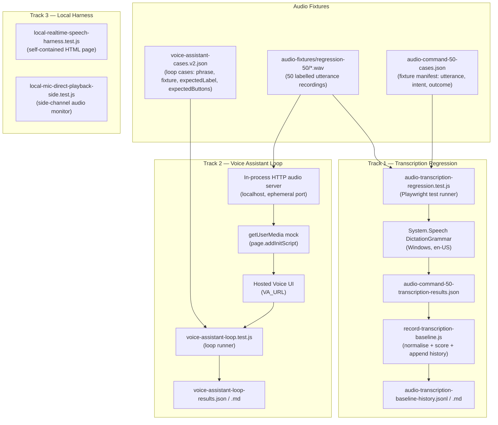
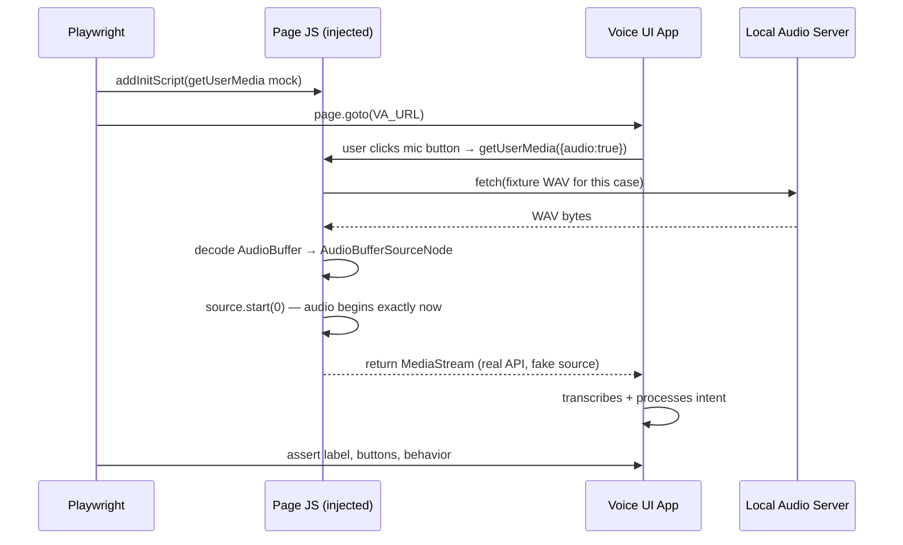

# Audio Testing Harness

> A Playwright-based test harness for validating speech transcription accuracy and voice-driven UI behaviour. Two independent testing tracks — offline transcription regression and live voice assistant loop testing — share a common fixture library and baseline infrastructure.

**Stack:** Node.js · Playwright · `nodejs-whisper` · `ffmpeg-static` · Windows `System.Speech`

---

## Overview

Voice-enabled UIs introduce a testing surface that traditional Playwright tests do not cover: the correctness of the audio → intent → UI response pipeline. This harness addresses that in two ways:

1. **Transcription regression** — decoupled from any UI, it validates whether a set of audio fixtures transcribe to their expected phrases. This is a measure of transcription engine quality and audio format suitability, tracked over time as a baseline history.

2. **Voice assistant loop testing** — end-to-end loops against a hosted voice UI. Each loop injects an audio fixture as a fake microphone stream, waits for the UI to respond, and asserts the response matches expected labels and action buttons. Works headless in CI or with live speaker output for manual observation.

---

## Architecture



---

## Track 1 — Transcription Regression

### What it tests

Each of the 50 audio fixture files contains a single spoken utterance. The test plays each file through the Windows `System.Speech.Recognition.SpeechRecognitionEngine` with a `DictationGrammar` and captures the transcribed text and confidence score. Results are compared against the expected utterance using normalised exact-match scoring (lowercase, punctuation removed, whitespace collapsed).

### Why this matters

Before testing any UI, you need confidence that the transcription engine is actually hearing what was said. This track isolates that question completely — there is no network call, no UI, no application server. If transcription quality regresses after an audio format change (sample rate, bit depth, mono/stereo, encoding), this test surface will catch it.

### Fixture schema (`audio-command-50-cases.json`)

```json
{
  "testCaseId": "ARM-P1-01",
  "feature": "Arm Panel",
  "scenarioName": "Arm panel in Stay mode",
  "given": "Panel is online and disarmed; User has Control Panel permission",
  "utterance": "Arm stay",
  "fixture": "audio-fixtures/regression-50/arm-p1-01.wav",
  "expectedIntent": "arm_stay",
  "expectedOutcome": "action"
}
```

Fixtures cover three intent categories:
- **Arm** (arm away, arm stay, arm night — various phrasings and hesitations)
- **Disarm** (disarm, cancel, never mind)
- **Clarify** (ambiguous or incomplete commands the system should ask the user to clarify)

### Running

```powershell
# Run the 50-case transcription test only
npm run test:transcription:50

# Run the test AND append a new entry to the baseline history
npm run baseline:transcription:50

# With profile metadata
$env:BASELINE_PROFILE = 'pcm16-48k-v2'
$env:BASELINE_NOTES   = 'Testing 48 kHz resample effect'
npm run baseline:transcription:50
```

### Output files

| File | Purpose |
|---|---|
| `audio-command-50-transcription-results.json` | Latest per-case run: actual phrase, transcribed text, confidence, outcome |
| `audio-command-50-transcription-results.md` | Markdown table of same data (human-readable) |
| `audio-transcription-baseline-history.jsonl` | Append-only machine-readable history (one JSON object per line) |
| `audio-transcription-baseline-history.md` | Append-only human-readable summary table |

### Baseline history format

Each `baseline:record` run appends one row to both history files:

```
| Timestamp | Profile | Pass | Fail | Pass Rate | Avg Confidence | Engine |
| 2026-02-13T19:20:34Z | v1-default | 17 | 33 | 34% | 0.527 | System.Speech DictationGrammar (en-US) |
```

This is the primary signal for evaluating whether an audio format or engine change is an improvement or regression. A profile that raises pass rate or average confidence without introducing new failures is a candidate for promotion.

### Environment variables

| Variable | Default | Purpose |
|---|---|---|
| `BASELINE_PROFILE` | `default` | Label for this run in history (e.g. `pcm16-48k-v2`) |
| `BASELINE_AUDIO_SOURCE` | `audio-fixtures/regression-50/*.wav` | Annotates what fixture set was used |
| `BASELINE_ENGINE` | `System.Speech DictationGrammar (en-US)` | Annotates which engine was used |
| `BASELINE_NOTES` | _(empty)_ | Free-text note appended to history entry |

> **Platform note:** The `System.Speech.Recognition` engine is Windows-only. The test skips automatically on non-Windows platforms. A separate `nodejs-whisper` integration is available as an alternative transcription backend.

---

## Track 2 — Voice Assistant Loop Testing

### What it tests

The voice assistant loop navigates to a hosted voice UI, injects an audio fixture as a fake microphone stream for each test case, and asserts the UI responds correctly:

- The response label matches `expectedLabel`
- The presented action buttons match `expectedButtons`
- The behaviour category (`action` vs `clarify`) is correct

### The fake microphone approach

The initial implementation used Chromium launch flags (`--use-fake-device-for-media-stream`, `--use-file-for-fake-audio-capture`) to inject audio. This approach has a fundamental timing problem: the WAV starts streaming the instant the browser launches — before the page loads and long before the user clicks the microphone button. Short utterances (1–2 seconds) were entirely consumed before the voice UI ever opened the mic stream.

The current implementation solves this by mocking `navigator.mediaDevices.getUserMedia` at the page JavaScript layer via `page.addInitScript()`:



**Benefits over the flag approach:**
- WAV playback starts at position 0 exactly when the mic is opened — no timing drift
- No `--use-fake-device-for-media-stream` flag required
- Browser can be reused across all cases (just re-inject the init script per loop) — eliminates 2–3s of browser startup overhead per case
- Full control over timing, pre-roll silence, or looping entirely in JS if needed

A lightweight in-process HTTP server (`http.createServer`) serves WAV files to the page's `fetch()` call on an ephemeral localhost port. The server is started in `test.beforeAll` and torn down in `test.afterAll`.

### Case schema (`voice-assistant-cases.v2.json`)

```json
{
  "id": "ACT-001",
  "phrase": "Arm the panel away",
  "fixture": "audio-fixtures/regression-50/arm-p1-02.wav",
  "expectedBehavior": "action",
  "expectedLabel": "Arm Away",
  "expectedButtons": ["Arm Away", "Cancel"]
}
```

Expected behaviours:
- **`action`** — the system resolved intent with high confidence; a specific action button is shown
- **`clarify`** — the utterance was ambiguous; the system presents multiple options and asks the user to confirm

### Running

```powershell
# Fake mic mode (Chromium only, no speakers needed)
$env:VA_URL = 'https://your-hosted-app-url'
npm run test:voice-assistant:fake

# Speaker/audio mode (plays WAV through system audio, mic captures it live)
$env:VA_URL = 'https://your-hosted-app-url'
npm run test:voice-assistant:audio
```

### Selector configuration

All selectors are injected via environment variables so the test runner is decoupled from any specific UI implementation:

| Variable | Purpose |
|---|---|
| `VA_URL` | Target app URL (test skips if unset) |
| `VA_READY_SELECTOR` | Element to wait for before starting (confirms app is loaded) |
| `VA_START_SELECTOR` | Mic button to click to start listening |
| `VA_RESPONSE_SELECTOR` | Element containing the response label to assert |
| `VA_BUTTON_SELECTOR` | Selector for action buttons to assert |
| `VA_CANCEL_SELECTOR` | Cancel/dismiss button to click after each case |

Example (using `data-testid` attributes):

```powershell
$env:VA_READY_SELECTOR    = '[data-testid="voice-widget"]'
$env:VA_START_SELECTOR    = '[data-testid="start-listening"]'
$env:VA_RESPONSE_SELECTOR = '[data-testid="assistant-label"]'
$env:VA_BUTTON_SELECTOR   = '[data-testid="assistant-option"]'
$env:VA_CANCEL_SELECTOR   = '[data-testid="assistant-cancel"]'
```

### Timing knobs

| Variable | Default | Purpose |
|---|---|---|
| `VA_POST_START_WAIT_MS` | `250` | Pause after clicking mic before audio begins |
| `VA_RESPONSE_WAIT_MS` | `8000` | Maximum wait for response label to appear |
| `VA_POST_CANCEL_WAIT_MS` | `500` | Pause after cancel before the next case begins |

### Pass-rate gate

At the end of a full loop run, the harness checks the overall pass rate against a configurable threshold:

| Variable | Default | Behaviour |
|---|---|---|
| `VA_MIN_PASS_RATE` | `75` | Run fails if pass % is below this value |

If all cases are skipped (`Total = 0`), no threshold failure is raised.

### Output files

| File | Purpose |
|---|---|
| `voice-assistant-loop-results.json` | Full run report: timestamp, mode, total/pass/fail counts, pass rate, threshold result, per-case rows |
| `voice-assistant-loop-results.md` | Markdown table of per-case results |

---

## Track 3 — Local Realtime Harness

Two supporting test files for local development and audio pipeline validation, neither of which requires a hosted URL.

### `local-realtime-speech-harness.test.js`

Spins up a self-contained HTML page in a headed Playwright browser. The page requests microphone access, captures audio for a configurable window, and reports bytes received and peak RMS level. Used to verify that the fake microphone injection pipeline is working before pointing it at a real application.

```powershell
# Default (silent monitor)
npm run test:realtime:local

# Audible mode — routes fake mic input to browser speaker output
$env:REALTIME_MONITOR_AUDIO = '1'
npm run test:realtime:local

# Extend capture window (default 4500 ms)
$env:REALTIME_CAPTURE_MS   = '7000'
$env:REALTIME_MONITOR_AUDIO = '1'
npm run test:realtime:local

# Override which WAV to inject
$env:VA_FAKE_MIC_WAV = 'arm_away_panel.wav'
npm run test:realtime:local
```

### `local-mic-direct-playback-side.test.js`

A side-channel monitor that routes the fake mic stream directly to the browser's audio output. Useful for confirming the audio content is correct before running loop tests.

```powershell
npm run test:realtime:side
```

---

## Project Structure

```
audio-fixtures/
  arm_stay_the_panel.wav         — Standalone fixture clips
  arm_the_panel_away.wav
  arm_wait.wav
  disarm_now.wav
  regression-50/                 — 50 labelled fixtures for the regression suite
    arm-p1-01.wav .. arm-p1-NN.wav
    dis-p1-NN.wav
    aud-p1-NN.wav

audio-command-50-cases.json      — Fixture manifest (utterance, intent, feature, outcome)
voice-assistant-cases.v2.json        — Loop test cases (phrase, fixture, expectedLabel, buttons)
voice-assistant-cases.skeleton.json  — Minimal skeleton for new case authoring

audio-transcription-regression.test.js   — Track 1: transcription regression runner
record-transcription-baseline.js         — Normalise + score + append baseline history
audio-transcription-baseline-history.jsonl  — Append-only machine-readable history
audio-transcription-baseline-history.md    — Append-only human-readable history table

voice-assistant-loop.test.js             — Track 2: full voice assistant loop runner
voice-assistant-fake-mic.test.js         — Track 2: single-case fake mic smoke test
run-voice-assistant.js                   — CLI launcher (passes --fake-mic or --audio)

local-realtime-speech-harness.test.js    — Track 3: local pipeline validation
local-mic-direct-playback-side.test.js   — Track 3: audio side-channel monitor

voice-assistant-loop-results.json / .md  — Output: latest loop run results
audio-command-50-transcription-results.json / .md  — Output: latest transcription run
```

---

## npm Scripts

| Script | What it runs |
|---|---|
| `test:transcription:50` | Transcription regression test (50 fixtures) |
| `baseline:transcription:50` | Transcription test + append to baseline history |
| `baseline:record` | Baseline record only (uses existing results file) |
| `test:voice-assistant` | Voice assistant loop — fake mic mode |
| `test:voice-assistant:fake` | Same as above |
| `test:voice-assistant:audio` | Voice assistant loop — live speaker/mic mode |
| `test:realtime:local` | Local realtime harness (headed) |
| `test:realtime:side` | Local audio side-channel monitor (headed) |

---

## Dependencies

| Package | Role |
|---|---|
| `@playwright/test ^1.58.2` | Browser automation, fake mic injection, test runner |
| `nodejs-whisper ^0.2.9` | Local Whisper AI speech-to-text (alternative transcription backend) |
| `ffmpeg-static ^5.3.0` | Audio format conversion and processing |
| `System.Speech` (.NET) | Windows built-in `DictationGrammar` recogniser (no install required) |

---

## Roadmap

**Contract / API checks alongside UI checks (planned)**

The current voice assistant loop validates UI correctness (labels, buttons) but does not independently verify that the backend intent model returned the correct payload. The planned addition intercepts Playwright network traffic during the UI run and asserts the raw `intent` and `options` fields from the API response in parallel with the UI assertions. This separates two distinct failure modes:

- **Model failure** — the backend classified the utterance incorrectly (fails the API assertion, passes the UI assertion)
- **UI failure** — the backend was correct but the UI rendered it wrong (passes the API assertion, fails the UI assertion)

Implementation options: direct API call with credentials from env vars, or Playwright `page.route()` interception of the response payload during the existing UI run.
